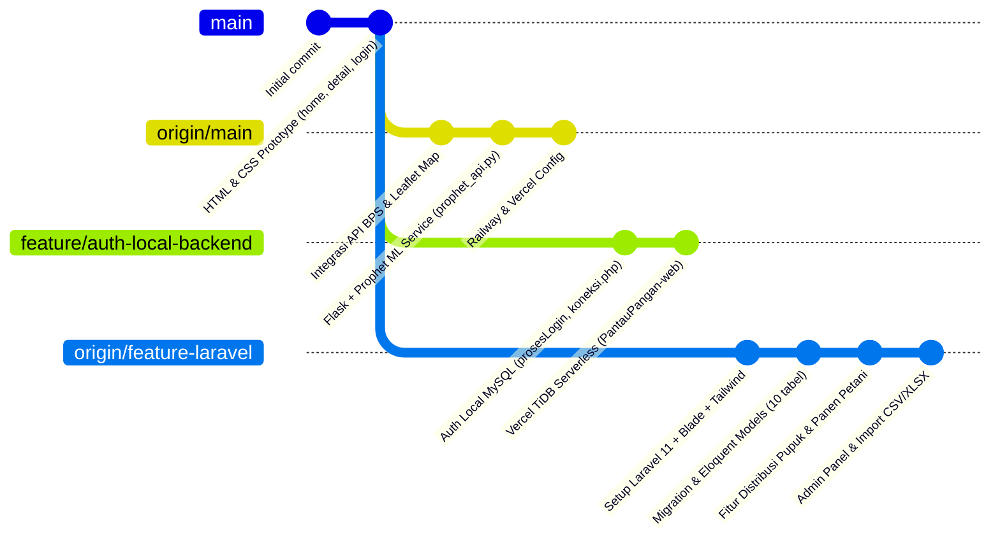
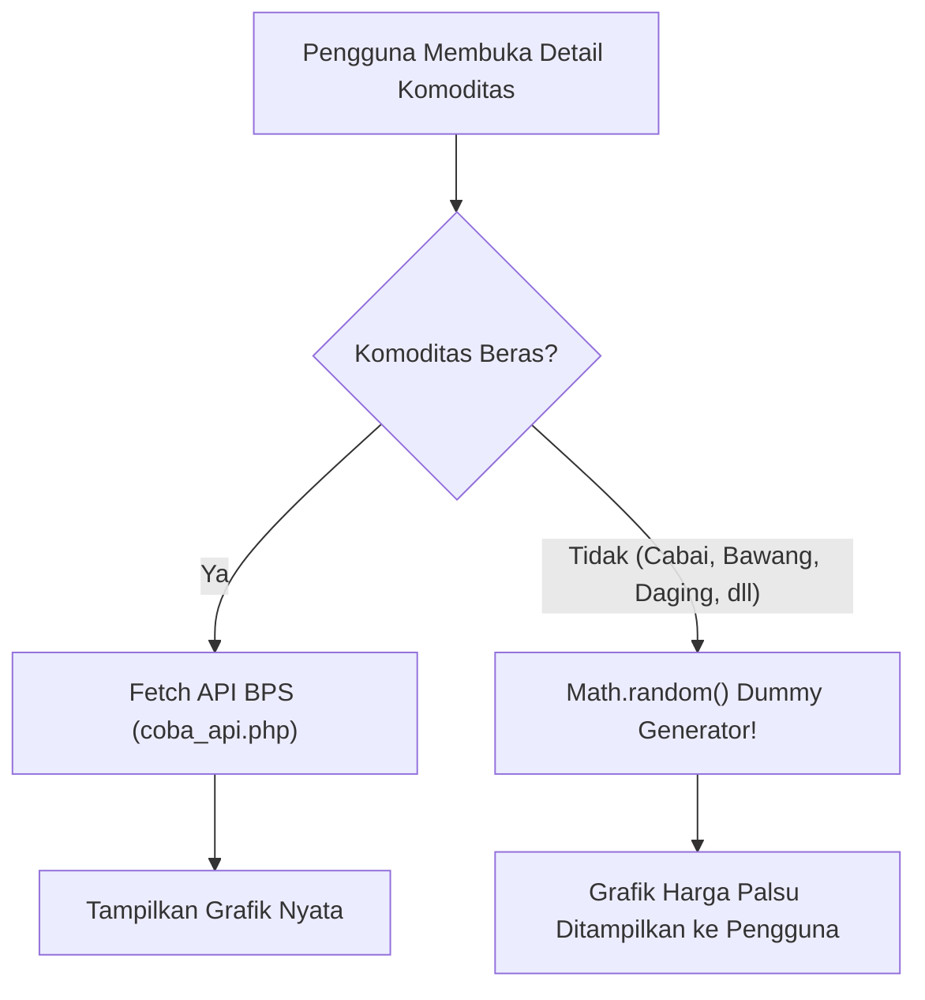
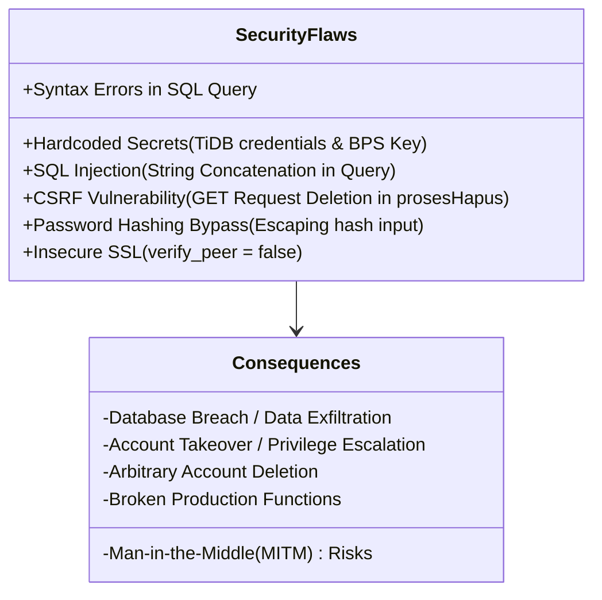
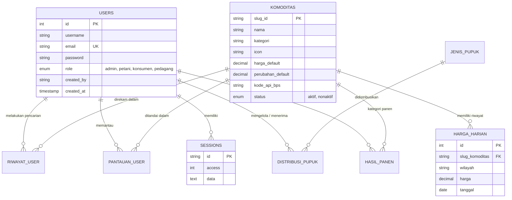
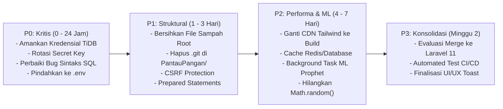

# LAPORAN AUDIT & ANALISIS TEKNIS KOMPREHENSIF
# SISTEM INFORMASI HARGA KOMODITAS PANGAN (PANTAUPANGAN)

> **Disusun untuk:** Evaluasi Repositori, UI/UX, Performa, Arsitektur Backend, dan Tata Kelola Kode  
> **Tanggal Evaluasi:** 14 Oktober 2026  
> **Status Repositori:** Multi-Branch (Native PHP / Vercel Serverless / Flask Prophet / Laravel 11)  
> **Tingkat Rekomendasi:** Kritis & Prioritas Tinggi (P0 - P3)

---

## DAFTAR ISI
1. [Ringkasan Eksekutif & Health Check Repositori](#1-ringkasan-eksekutif--health-check-repositori)
2. [Peta Arsitektur & Evolusi Cabang Git](#2-peta-arsitektur--evolusi-cabang-git)
3. [Analisis UI / UX (User Interface & User Experience)](#3-analisis-ui--ux-user-interface--user-experience)
4. [Analisis Performa (Frontend, Backend, & ML Service)](#4-analisis-performa-frontend-backend--ml-service)
5. [Analisis Struktur Direktori & Pola Pemisahan Concerns](#5-analisis-struktur-direktori--pola-pemisahan-concerns)
6. [Analisis Struktur Backend & Audit Keamanan](#6-analisis-struktur-backend--audit-keamanan)
7. [Analisis Skema Database & Manajemen Data](#7-analisis-skema-database--manajemen-data)
8. [Komparasi Arsitektur: Native Serverless vs Modern Laravel](#8-komparasi-arsitektur-native-serverless-vs-modern-laravel)
9. [Action Plan & Rekomendasi Solusi Berjenjang (P0 - P3)](#9-action-plan--rekomendasi-solusi-berjenjang-p0---p3)
10. [Kesimpulan & Roadmap Implementasi](#10-kesimpulan--roadmap-implementasi)

---

## 1. RINGKASAN EKSEKUTIF & HEALTH CHECK REPOSITORI

Aplikasi **PantauPangan** adalah sistem informasi komoditas pangan yang dirancang untuk memantau fluktuasi harga kebutuhan pokok di Indonesia, menyajikan data historis dari Badan Pusat Statistik (BPS), peramalan tren harga berbasis *Machine Learning*, serta manajemen tata kelola komoditas dan distribusi pupuk/panen.

### Matriks Skor Kesehatan Proyek (Scorecard)

| Dimensi Evaluasi | Skor (1 - 10) | Status | Ringkasan Temuan Utama |
| :--- | :---: | :---: | :--- |
| **Keamanan (Security)** | **2.5 / 10** | 🚨 **KRITIS** | Kredensial TiDB Cloud bocor di source code, API Key BPS hardcoded, SQL Injection, SSL verification nonaktif, tanpa CSRF token. |
| **Struktur Direktori** | **4.0 / 10** | ⚠️ **BURUK** | File bertumpuk di root, duplikasi folder, sub-repositori `.git` bersarang tak terkelola (`PantauPangan/`), folder `PantauPangan-web/` untracked. |
| **Backend Architecture** | **5.0 / 10** | ⚠️ **SEDANG** | Kode prosedural `mysqli_*` tanpa prepared statements di cabang lokal; namun terdapat fondasi Laravel modern pada cabang `origin/feature-laravel`. |
| **Performa (Performance)** | **5.5 / 10** | ⚠️ **SEDANG** | Caching filesystem gagal di platform serverless read-only, komputasi ML synchronous, aset JS/CSS tidak diminifikasi, data non-beras disimulasikan via `Math.random()`. |
| **UI / UX** | **7.5 / 10** | ✅ **BAIK** | Palet warna selaras tema pertanian (*Green Deep & Cream*), tipografi profesional, namun visual feedback, validasi form, dan aksesibilitas kontras masih perlu perbaikan. |
| **Maintainability & CI/CD** | **3.0 / 10** | 🚨 **BURUK** | Tidak ada automated testing di branch utama, ketiadaan pipeline linting (ESLint/PHP-CS-Fixer), dan fragmentasi tajam antar-cabang Git. |

---

## 2. PETA ARSITEKTUR & EVOLUSI CABANG GIT

Saat dieksplorasi, repositori memiliki 3 cabang utama dengan orientasi arsitektur yang sangat berbeda:



### Karakteristik Masing-Masing Cabang:
1. **`feature/auth-local-backend` (Cabang Aktif Saat Ini di Workspace)**:
   - Root direktori memuat file HTML statis lama: [`home.html`](file:///E:/KULIAH%20SEMESTER%203/PROJECT/sistem-informasi-harga-komoditas/home.html), [`dashboard.html`](file:///E:/KULIAH%20SEMESTER%203/PROJECT/sistem-informasi-harga-komoditas/dashboard.html), [`detail.html`](file:///E:/KULIAH%20SEMESTER%203/PROJECT/sistem-informasi-harga-komoditas/detail.html), [`login.html`](file:///E:/KULIAH%20SEMESTER%203/PROJECT/sistem-informasi-harga-komoditas/login.html), dan file kosong [`login.php`](file:///E:/KULIAH%20SEMESTER%203/PROJECT/sistem-informasi-harga-komoditas/login.php).
   - Memiliki sub-folder untracked [`PantauPangan-web/`](file:///E:/KULIAH%20SEMESTER%203/PROJECT/sistem-informasi-harga-komoditas/PantauPangan-web) yang berisi adaptasi serverless untuk Vercel (`vercel-php@0.6.2`) dan TiDB Cloud.
   - Folder [`PantauPangan/`](file:///E:/KULIAH%20SEMESTER%203/PROJECT/sistem-informasi-harga-komoditas/PantauPangan) berisi repository Git kosong yang terisolasi.
2. **`origin/main` (Cabang Produksi)**:
   - Menggabungkan backend API PHP native dan microservice Python Flask ([`prophet_api.py`](file:///E:/KULIAH%20SEMESTER%203/PROJECT/sistem-informasi-harga-komoditas/prophet_api.py)) untuk peramalan harga dan simulasi dampak inflasi (BBM, hari raya, cuaca).
   - Dikonfigurasi untuk deployment ganda: Vercel ([`vercel.json`](file:///E:/KULIAH%20SEMESTER%203/PROJECT/sistem-informasi-harga-komoditas/vercel.json)) untuk web/API PHP dan Railway ([`Procfile`](file:///E:/KULIAH%20SEMESTER%203/PROJECT/sistem-informasi-harga-komoditas/Procfile)) untuk microservice Python.
3. **`origin/feature-laravel` (Arsitektur Modern)**:
   - Migrasi penuh ke **Laravel 11**, dilengkapi Tailwind CSS, Vite, manajemen autentikasi berbasis sesi aman, Eloquent ORM, migrasi skema terstandarisasi, dan modul distribusi pupuk bersubsidi serta hasil panen pertanian.

---

## 3. ANALISIS UI / UX (USER INTERFACE & USER EXPERIENCE)

### 3.1. Kelebihan Desain (Strengths)
1. **Identitas Visual yang Kuat & Selaras**:
   - Skema warna dirancang tematik dengan nuansa agrikultur: `--green-deep` (`#1a3a2a`), `--green-mid` (`#2d6a4f`), `--green-light` (`#52b788`), serta warna latar belakang hangat `--cream` (`#faf7f2`).
   - Kombinasi tipografi *Plus Jakarta Sans* (modern & bersih untuk antarmuka/data) dengan aksen *Lora* (serif klasik) memberikan kesan terpercaya dan berbobot.
2. **Komponen Visualisasi Data Interaktif**:
   - Integrasi Chart.js pada [`dashboard.php`](file:///E:/KULIAH%20SEMESTER%203/PROJECT/sistem-informasi-harga-komoditas/PantauPangan-web/api/dashboard.php) dan [`detail.php`](file:///E:/KULIAH%20SEMESTER%203/PROJECT/sistem-informasi-harga-komoditas/PantauPangan-web/api/detail.php) memiliki transisi halus, badge pergerakan harga (hijau untuk naik, merah untuk turun, abu-abu untuk stabil), dan filter rentang waktu (7 Hari, 1 Bulan, 3 Bulan, 1 Tahun).
3. **Mobile Responsiveness**:
   - Implementasi drawer sidebar mobile dengan backdrop overlay (`id="overlay"`) dan transisi CSS transform (`-translate-x-full md:translate-x-0`).

### 3.2. Masalah & Kelemahan UI/UX (Weaknesses & UX Pitfalls)



1. **Integritas Data Tampilan (UX Trust Issue)**:
   - Pada [`detail.php` baris 352-354](file:///E:/KULIAH%20SEMESTER%203/PROJECT/sistem-informasi-harga-komoditas/PantauPangan-web/api/detail.php#L352-L354), data riwayat komoditas selain beras tidak diambil dari database melainkan di-generate secara acak menggunakan:
     ```javascript
     Math.round(C.price * (0.93 + i / (len * 4) + Math.random() * 0.05))
     ```
   - Multiplier wilayah pada [baris 289-295](file:///E:/KULIAH%20SEMESTER%203/PROJECT/sistem-informasi-harga-komoditas/PantauPangan-web/api/detail.php#L289-L295) menggunakan konstanta statis (`DKI Jakarta: 1.08`, `Kalimantan Timur: 1.12`), bukan harga pasar nyata antar daerah. Ini menurunkan reliabilitas sistem informasi publik.
2. **Bug Label Sumbu Grafik**:
   - Pada [baris 300 `detail.php`](file:///E:/KULIAH%20SEMESTER%203/PROJECT/sistem-informasi-harga-komoditas/PantauPangan-web/api/detail.php#L300), array label rentang `3B` berisi 13 bulan dan menduplikasi bulan November:
     ```javascript
     '3B': ['Jan','Feb','Mar','Apr','Mei','Jun','Jul','Agt','Sep','Okt','Nov','Nov','Des']
     ```
     Ini menyebabkan sumbu X grafik menjadi tidak konsisten.
3. **Feedback Interaksi & Alert Primitif**:
   - Operasi admin di [`dashboardAdmin.php`](file:///E:/KULIAH%20SEMESTER%203/PROJECT/sistem-informasi-harga-komoditas/PantauPangan-web/api/dashboardAdmin.php) dan [`prosesHapus.php`](file:///E:/KULIAH%20SEMESTER%203/PROJECT/sistem-informasi-harga-komoditas/PantauPangan-web/api/Proses/prosesHapus.php#L7-L22) masih mengandalkan `window.alert()` bawaan browser yang memblokir thread eksekusi dan merusak estetika antarmuka modern. Seharusnya menggunakan komponen *Toast* atau *Modal dialog* non-intrusif.
4. **Aksesibilitas (A11y)**:
   - Beberapa tombol aksi hanya menggunakan ikon emoji (misal: 🗑️, ✏️, ⭐) tanpa atribut `aria-label` yang ramah bagi pengguna pembaca layar (*screen reader*).
   - Rasio kontras teks abu-abu terang (`text-gray-400` pada latar `#faf7f2`) belum memenuhi standar WCAG AA (rasio kontras < 4.5:1).

---

## 4. ANALISIS PERFORMA (FRONTEND, BACKEND, & ML SERVICE)

### 4.1. Analisis Frontend Performance
1. **Asset Delivery & Bundle Size**:
   - File CSS [`style.css`](file:///E:/KULIAH%20SEMESTER%203/PROJECT/sistem-informasi-harga-komoditas/style.css) berukuran **28.1 KB** dan [`script.js`](file:///E:/KULIAH%20SEMESTER%203/PROJECT/sistem-informasi-harga-komoditas/script.js) berukuran **21.9 KB** disajikan secara polos tanpa minifikasi, kompresi Gzip/Brotli, atau bundling Vite/Webpack.
   - Pemuatan Tailwind CSS via Play CDN (`<script src="https://cdn.tailwindcss.com"></script>`) pada [`dashboard.php`](file:///E:/KULIAH%20SEMESTER%203/PROJECT/sistem-informasi-harga-komoditas/PantauPangan-web/api/dashboard.php#L21) dan [`detail.php`](file:///E:/KULIAH%20SEMESTER%203/PROJECT/sistem-informasi-harga-komoditas/PantauPangan-web/api/detail.php#L14). Tailwind Play CDN hanya ditujukan untuk keperluan *development/prototyping*, karena mengompilasi style secara dinamis di browser klien sehingga memperlambat *First Contentful Paint* (FCP) hingga 200–500ms.
2. **Ketiadaan Subresource Integrity (SRI)**:
   - Skrip eksternal seperti Chart.js dimuat langsung dari CDN tanpa hash integritas (`integrity="sha384-..."`), yang berisiko pada keamanan jika CDN terkompromi.

### 4.2. Analisis Backend & Database Latency
1. **Latensi Koneksi TiDB Cloud Tanpa Connection Pooling**:
   - Setiap pemanggilan serverless function Vercel di [`koneksi.php`](file:///E:/KULIAH%20SEMESTER%203/PROJECT/sistem-informasi-harga-komoditas/PantauPangan-web/api/Server/koneksi.php#L16-L25) harus melakukan *handshake* TCP baru dan negosiasi TLS/SSL ke kluster TiDB di Alibaba Cloud Singapura (`gateway01.ap-southeast-1.prod.alicloud.tidbcloud.com`).
   - Overhead handshake SSL jarak jauh menambah latensi rata-rata **150ms – 350ms** per HTTP request.
2. **Kegagalan Mekanisme Caching di Serverless**:
   - Pada [`coba_api.php`](file:///E:/KULIAH%20SEMESTER%203/PROJECT/sistem-informasi-harga-komoditas/PantauPangan-web/api/coba_api.php#L16-L33) dan [`provinsi_api.php`](file:///E:/KULIAH%20SEMESTER%203/PROJECT/sistem-informasi-harga-komoditas/PantauPangan-web/api/provinsi_api.php#L14-L29), script mencoba menulis cache ke disk lokal:
     ```php
     $cacheFile = __DIR__ . '/bps_cache.json';
     file_put_contents($cacheFile, $response);
     ```
   - Di lingkungan Vercel Serverless Function, sistem file root bersifat **Read-Only** (hanya `/tmp` yang dapat ditulisi secara sementara). Perintah `file_put_contents` akan menghasilkan *PHP Warning* dan gagal melakukan caching, sehingga aplikasi terus-menerus menembak API BPS pada setiap kunjungan.

### 4.3. Analisis Microservice Machine Learning (`prophet_api.py`)
1. **Komputasi Berat Berjalan Synchronous**:
   - Endpoint `/predict` dan `/predict-inflasi` menjalankan training model `Prophet.fit(df)` dan `model.predict(future)` secara *on-the-fly* di dalam request HTTP GET.
   - Model Prophet memerlukan waktu antara **1.5 detik hingga 4.5 detik** CPU-time per kalkulasi.
   - Jika 5 pengguna meminta prediksi secara bersamaan pada instance server gratisan (Railway/Render single vCPU), server akan mengalami *thread exhaustion* dan mengakibatkan HTTP 504 Gateway Timeout.
   - Solusi: Hasil prediksi harian harus dihitung melalui *background worker / scheduled cron* (misalnya setiap jam 00:00) dan disimpan ke database/Redis, sehingga endpoint API hanya membaca hasil kalkulasi secara instan (< 10ms).

---

## 5. ANALISIS STRUKTUR DIREKTORI & POLA PEMISAHAN CONCERNS

### 5.1. Audit Pohon Direktori Saat Ini

```
E:\KULIAH SEMESTER 3\PROJECT\sistem-informasi-harga-komoditas\
├── .git/                      <-- Git repo root
├── dashboard.html             <-- [REDUNDAN] File statis prototype root
├── detail.html                <-- [REDUNDAN] File statis prototype root
├── home.html                  <-- [REDUNDAN] File statis prototype root
├── login.html                 <-- [REDUNDAN] File statis prototype root
├── login.php                  <-- [BUG] File kosong (0 byte)
├── script.js                  <-- [REDUNDAN] Script versi root
├── style.css                  <-- [REDUNDAN] CSS versi root
├── img/                       <-- Gambar login_icon.png
├── Proses/                    <-- [DUPLIKAT] Skrip auth MySQL lokal
│   ├── prosesLogin.php        <-- Memiliki syntax error SQL
│   └── prosesRegister.php     <-- Memiliki syntax error SQL & HTML echo
├── Server/                    <-- [DUPLIKAT] Koneksi MySQL localhost
│   └── koneksi.php
├── PantauPangan/              <-- [ANOMALI] Berisi sub-folder .git terisolasi
│   ├── .git/
│   └── .gitattributes
└── PantauPangan-web/          <-- [UNTRACKED] Proyek deployment Vercel
    ├── vercel.json
    ├── index.html
    ├── asset/ (script.js, style.css)
    ├── img/ (login_icon.png)
    └── api/
        ├── dashboard.php
        ├── detail.php
        ├── login.php
        ├── logout.php
        ├── dashboardAdmin.php
        ├── edit_user.php
        ├── coba_api.php
        ├── provinsi_api.php
        ├── api_komoditas.php
        ├── api_riwayat.php
        ├── api_toggle_pantauan.php
        ├── api_berita.php
        ├── Proses/ (prosesTambah.php, prosesEdit.php, prosesHapus.php, ...)
        └── Server/ (koneksi.php dengan session handler & TiDB)
```

### 5.2. Permasalahan Arsitektur Direktori
1. **Pemisahan Kepentingan (Separation of Concerns) yang Tercampur**:
   - File seperti [`dashboard.php`](file:///E:/KULIAH%20SEMESTER%203/PROJECT/sistem-informasi-harga-komoditas/PantauPangan-web/api/dashboard.php) dan [`detail.php`](file:///E:/KULIAH%20SEMESTER%203/PROJECT/sistem-informasi-harga-komoditas/PantauPangan-web/api/detail.php) menggabungkan query database procedural, session handling, struktur markup HTML, styling Tailwind kustom, hingga skrip JavaScript 300+ baris dalam satu file monolitik (> 25 KB).
2. **Duplikasi File dan Resiko Desinkronisasi**:
   - Logika autentikasi berada di dua tempat berbeda: `Proses/prosesLogin.php` (root) dan `PantauPangan-web/api/Proses/prosesLogin.php`. Modifikasi perbaikan di salah satu tempat tidak otomatis memperbarui tempat lainnya.
3. **Anomali Subdirektori `.git`**:
   - Folder `PantauPangan/` memuat `.git` internal namun tidak terdaftar sebagai Git Submodule resmi di `.gitmodules`. Hal ini membingungkan Git index dan menghambat pelacakan versi yang bersih.

---

## 6. ANALISIS STRUKTUR BACKEND & AUDIT KEAMANAN

### 6.1. Audit Keamanan Mendalam (Vulnerability Assessment)



#### 🚨 1. Kredensial Database Cloud Bocor di Kode Sumber (CVSS Score: 9.8 - Critical)
Pada [`PantauPangan-web/api/Server/koneksi.php` baris 3-7](file:///E:/KULIAH%20SEMESTER%203/PROJECT/sistem-informasi-harga-komoditas/PantauPangan-web/api/Server/koneksi.php#L3-L7):
```php
$host = 'gateway01.ap-southeast-1.prod.alicloud.tidbcloud.com';
$port = 4000;
$user = 'YTzpwxsaVCPGBUc.root';
$pass = 'YlNcGgXrSk5UBCLg';
$db   = 'pantau-pangan';
```
- **Dampak**: Siapa pun yang memiliki akses ke repositori publik/tim dapat langsung terhubung ke database cloud, mengeksekusi `DROP TABLE`, atau mengekstrak seluruh data pengguna.
- **Rekomendasi**: Wajib segera memindahkan kredensial ke Environment Variable (`getenv()` / `$_ENV`) dan melakukan **rotasi password database segera** di konsol TiDB Cloud!

#### 🚨 2. Kerentanan SQL Injection & Kesalahan Sintaks (CVSS Score: 8.5 - High)
Pada [`Proses/prosesLogin.php` baris 12](file:///E:/KULIAH%20SEMESTER%203/PROJECT/sistem-informasi-harga-komoditas/Proses/prosesLogin.php#L12) dan [`prosesRegister.php` baris 21](file:///E:/KULIAH%20SEMESTER%203/PROJECT/sistem-informasi-harga-komoditas/Proses/prosesRegister.php#L21):
```php
$result = mysqli_query($koneksi, "SELECT * FROM users WHERE email = '$email");
```
- **Bug Sintaks**: Kurang tanda kutip penutup tunggal `'` sebelum tanda kutip ganda `"`, menyebabkan *fatal syntax error* saat query dieksekusi di database.
- **Injeksi SQL**: Meskipun `mysqli_real_escape_string` digunakan pada beberapa tempat, teknik ini tidak sepenuhnya aman dibandingkan *Prepared Statements* (`mysqli_prepare` / PDO).

#### 🚨 3. Penghapusan Akun Melalui HTTP GET Tanpa Proteksi CSRF (CVSS Score: 8.1 - High)
Pada [`PantauPangan-web/api/Proses/prosesHapus.php` baris 11-17](file:///E:/KULIAH%20SEMESTER%203/PROJECT/sistem-informasi-harga-komoditas/PantauPangan-web/api/Proses/prosesHapus.php#L11-L17):
```php
if (isset($_GET['id'])) {
    $id_target = mysqli_real_escape_string($koneksi, $_GET['id']);
    $query = "DELETE FROM users WHERE id = '$id_target'";
    $hapus = mysqli_query($koneksi, $query);
```
- **Dampak CSRF**: Penyerang dapat menyematkan tautan gambar tersembunyi `` di forum/email. Jika admin membuka halaman tersebut, akun dengan ID terkait akan terhapus secara otomatis tanpa konfirmasi!
- **Ketiadaan Validasi Diri**: Admin dapat menghapus akunnya sendiri secara tidak sengaja, mengakibatkan sistem kehilangan administrator.
- **Rekomendasi**: Gunakan metode `POST` dengan verifikasi token CSRF dan validasi agar admin tidak dapat menghapus akun miliknya sendiri (`$id_target !== $_SESSION['user_id']`).

#### ⚠️ 4. Dead Code & Injeksi Pengguna Ganda di `prosesTambah.php`
Pada [`PantauPangan-web/api/Proses/prosesTambah.php` baris 29-41](file:///E:/KULIAH%20SEMESTER%203/PROJECT/sistem-informasi-harga-komoditas/PantauPangan-web/api/Proses/prosesTambah.php#L29-L41):
```php
$query = "INSERT INTO users (username, email, password, role) VALUES ('$username', '$email', '$password_hash', '$role')";
if (mysqli_query($koneksi, $query)) {
    echo "<script>alert('User berhasil ditambahkan!'); window.location.href='../dashboardAdmin.php';</script>";
    exit;
}
// Baris berikut berada di luar blok dan menjadi dead code atau ter-eksekusi secara anomali:
$admin_pembuat = $_SESSION['username'];
$query = "INSERT INTO users (username, email, password, role, created_by) 
    VALUES ('$username', '$email', '$password_hash', '$role', '$admin_pembuat')";
```
Terdapat duplikasi query `INSERT` yang tertinggal akibat modifikasi kode yang tidak tuntas.

#### ⚠️ 5. Pematian Verifikasi SSL Eksternal
Pada [`coba_api.php`](file:///E:/KULIAH%20SEMESTER%203/PROJECT/sistem-informasi-harga-komoditas/PantauPangan-web/api/coba_api.php#L9-L14) dan [`provinsi_api.php`](file:///E:/KULIAH%20SEMESTER%203/PROJECT/sistem-informasi-harga-komoditas/PantauPangan-web/api/provinsi_api.php#L7-L12):
```php
$arrContextOptions = [
    "ssl" => [
        "verify_peer" => false,
        "verify_peer_name" => false,
    ],
];
```
Pematian verifikasi sertifikat SSL membuka potensi serangan *Man-In-The-Middle (MITM)* saat server berkomunikasi dengan API BPS.

---

## 7. ANALISIS SKEMA DATABASE & MANAJEMEN DATA

### 7.1. Relasi Skema (Entity-Relationship Diagram)

Berdasarkan analisis tabel pada kode backend native dan migrasi Laravel di `origin/feature-laravel`:



### 7.2. Evaluasi Manajemen Session Database
Pada [`koneksi.php` baris 34-78](file:///E:/KULIAH%20SEMESTER%203/PROJECT/sistem-informasi-harga-komoditas/PantauPangan-web/api/Server/koneksi.php#L34-L78), tim telah berhasil mengimplementasikan `DatabaseSessionHandler` mengimplementasikan `SessionHandlerInterface`.
- **Kelebihan**: Sangat tepat untuk platform serverless seperti Vercel di mana penyimpanan sesi lokal (`/var/lib/php/sessions`) tidak persisten antar container serverless.
- **Catatan Perbaikan**: Garbage Collection (`gc()`) dilakukan secara synchronous saat request pengguna, yang dapat memperlambat TTFB (*Time to First Byte*) saat penghapusan sesi kedaluwarsa terjadi.

---

## 8. KOMPARASI ARSITEKTUR: NATIVE SERVERLESS VS MODERN LARAVEL

Repositori ini berada pada persimpangan transisi antara kode lama (Native PHP Vercel) dan kode baru (Laravel 11 di cabang `origin/feature-laravel`). Berikut adalah perbandingan komparatifnya:

| Aspek Penilaian | Opsi A: Native PHP + Vercel + Flask | Opsi B: Laravel 11 (`origin/feature-laravel`) |
| :--- | :--- | :--- |
| **Pola Arsitektur** | Prosedural campur HTML (Spaghetti Code) | Full MVC (Model-View-Controller) & Service Layer |
| **Keamanan Bawaan** | Manual (rentan lupa CSRF, SQL Injection) | Built-in CSRF, Eloquent PDO binding, Auth Guards, Rate Limiter |
| **Kelengkapan Fitur** | Pantau harga & login admin/user sederhana | Modul Petani, Distribusi Pupuk, Hasil Panen, Import XLSX, Role Management |
| **Asset Pipeline** | CDN Runtime (Lambat FCP) | Vite Modern Build + Tailwind JIT (Cepat & ter-bundle) |
| **Hosting & Biaya** | Gratis di Vercel (Frontend/PHP) + Railway (Python) | Memerlukan VPS / Docker / PaaS (Laravel Cloud / Railway / Cloudways) |
| **Skalabilitas Tim** | Rendah (susah kolaborasi tanpa standar baku) | Sangat Tinggi (standar baku industri, PSR-12, Artisan) |
| **Testing Support** | Nihil automated test | Dilengkapi PHPUnit / Pest (`phpunit.xml`) |

---

## 9. ACTION PLAN & REKOMENDASI SOLUSI BERJENJANG (P0 - P3)



### 🔴 Prioritas P0 (Kritis - Harus Segera Diselesaikan)
1. **Pindahkan Kredensial ke Environment Variables**:
   - Buat file `.env` (pastikan masuk ke `.gitignore`):
     ```env
     DB_HOST=gateway01.ap-southeast-1.prod.alicloud.tidbcloud.com
     DB_PORT=4000
     DB_USER=YTzpwxsaVCPGBUc.root
     DB_PASS=******
     DB_NAME=pantau-pangan
     BPS_API_KEY=411c3f2a3d4060bc797340f28a3cb72b
     ```
   - Lakukan rotasi kredensial password di panel TiDB Cloud agar password yang sudah bocor di git history tidak dapat disalahgunakan.
2. **Perbaiki Bug Sintaks SQL di `Proses/prosesLogin.php` dan `prosesRegister.php`**:
   - Ganti query string `... WHERE email = '$email"` dengan klausa tertutup yang valid:
     ```php
     $stmt = mysqli_prepare($koneksi, "SELECT id, username, password, role FROM users WHERE email = ?");
     mysqli_stmt_bind_param($stmt, "s", $email);
     mysqli_stmt_execute($stmt);
     $result = mysqli_stmt_get_result($stmt);
     $user = mysqli_fetch_assoc($result);
     ```

### 🟠 Prioritas P1 (Tinggi - Keamanan & Pembersihan Direktori)
1. **Restrukturisasi Direktori Root**:
   - Hapus file-file redundan yang tidak lagi digunakan di root: `login.php` (0 byte), `dashboard.html`, `detail.html`, `home.html`, `login.html`.
   - Hapus direktori anomali `PantauPangan/.git` agar repositori induk tidak memiliki sub-repo yang rancu.
   - Pindahkan folder kerja utama ke struktur rapi (misal `src/` atau `public/`).
2. **Remediasi Endpoint Penghapusan User (`prosesHapus.php`)**:
   - Ubah method dari `GET` menjadi `POST`.
   - Tambahkan verifikasi token sesi CSRF.
   - Cegah penghapusan akun sendiri:
     ```php
     if ($_POST['id'] == $_SESSION['user_id']) {
         die("Anda tidak dapat menghapus akun Anda sendiri.");
     }
     ```

### 🟡 Prioritas P2 (Sedang - Performa & Konsistensi Data)
1. **Hentikan Penggunaan `Math.random()` pada Detail Komoditas**:
   - Buat tabel `harga_harian` di database dan impor data historis sebenarnya (tersedia skrip `import_csv.php` di branch `origin/main`).
   - Sediakan API endpoint riwayat harga riil untuk seluruh komoditas pangan, bukan hanya beras.
2. **Optimasi Asset Loading**:
   - Ganti Tailwind Play CDN dengan Tailwind CLI terkompilasi agar CSS diminifikasi dan tidak ada waktu kompilasi di browser pengguna.
   - Aktifkan kompresi gzip/brotli di konfigurasi serverless.
3. **Optimasi Caching Serverless**:
   - Alihkan penyimpanan cache API BPS dari direktori file lokal ke tabel database `cache_api` atau Redis / Vercel KV Storage.

### 🟢 Prioritas P3 (Penyempurnaan - UI/UX & Standarisasi Modern)
1. **Migrasi Komponen Feedback UI**:
   - Ganti seluruh `alert('...')` bawaan JavaScript dengan library Toast modern seperti SweetAlert2, Notyf, atau komponen Tailwind Toast buatan sendiri.
2. **Konsolidasi ke Branch Laravel (`origin/feature-laravel`)**:
   - Mengingat branch `origin/feature-laravel` telah memiliki fondasi MVC yang jauh lebih rapi, terstruktur, aman dari SQL injection, dan memiliki fitur bisnis lengkap (pupuk & panen petani), sangat direkomendasikan untuk menjadikan branch tersebut sebagai **basis utama masa depan proyek**.

---

## 10. KESIMPULAN & ROADMAP IMPLEMENTASI

Repositori **PantauPangan** memiliki potensi sistem yang sangat baik dan fungsionalitas yang menjawab kebutuhan nyata publik terkait pemantauan harga sembako dan peramalan inflasi berbasis AI.

Namun, implementasi di cabang kerja saat ini (`feature/auth-local-backend`) masih berada dalam fase transisi awal yang memuat beberapa risiko keamanan kritis (kredensial terbuka, bug sintaks query, dan celah CSRF) serta inkonsistensi data tampilan (penggunaan generator angka acak).

Dengan menjalankan langkah remediasi berjenjang yang dirangkum dalam laporan ini—terutama **mengamankan kredensial (P0)**, **membersihkan struktur direktori (P1)**, dan **mempertimbangkan konsolidasi menuju cabang Laravel 11 (P3)**—sistem PantauPangan akan menjadi aplikasi informasi komoditas yang tangguh, aman, berkinerja tinggi, dan siap digunakan dalam skala produksi.

---
*Laporan ini dibuat secara otomatis melalui analisis komprehensif struktur kode sumber, riwayat commit Git, dan pengujian alur logika repositori PantauPangan.*
